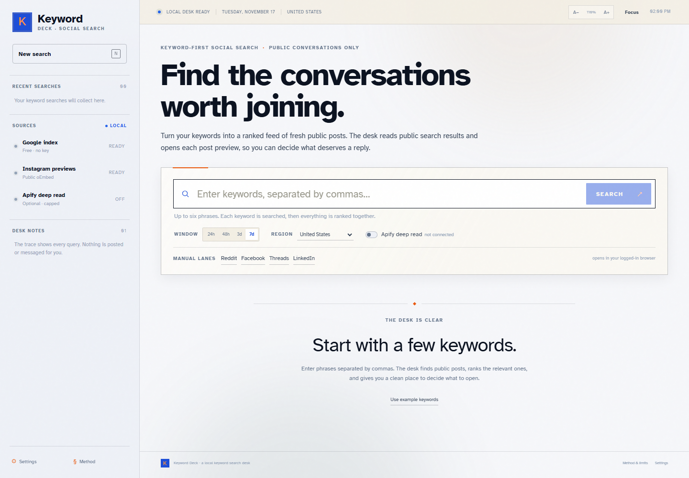
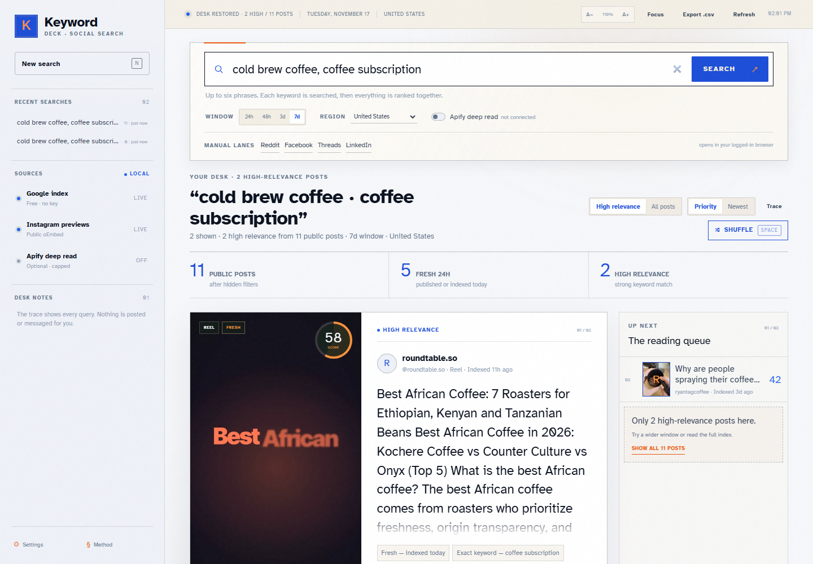

# Keyword Deck

A local-first social search desk for any niche. Enter a few keywords, and Keyword Deck builds a ranked deck of fresh public posts worth opening.

This is the blank, shareable version: no preloaded niche, no bundled keywords, no accounts, no sample data.

It is published as a free **proof-of-work** project: plain Node.js, no UI framework, 14 tests, a local HTTP server, and a complete working desktop experience.



After a keyword search:



## What it does

- Searches Google's public Instagram index for each keyword you enter.
- Resolves Google's signed links to the original public Instagram posts.
- Pulls public captions and preview images through Instagram's oEmbed endpoint.
- Ranks every post with **High relevance / Low relevance** based on exact keyword matches, freshness, keyword overlap, questions/advice, engagement when available, and promo penalties.
- Opens manual search lanes for Reddit, Facebook, Threads and LinkedIn in your default logged-in browser.
- Optionally adds Apify post metrics and exact timestamps.
- Saves, hides and marks posts contacted locally.
- Exports the current desk to CSV.

## Sources

Instagram posts are found through Google's public index. The Google row in the Sources panel is the search itself, so clicking it turns the search off; that leaves Apify as the only source. With both off, Search stops and tells you why.

The Google index leans toward news publishers, so some results read like headlines rather than creator posts. Apify returns a different set.

## You need Chrome

The desk searches Google for Instagram posts, the same way you would in a browser. Google blocks scripted requests, so the desk does not fetch results itself. It opens **Google Chrome** with your own profile, loads the exact search URL, reads the result links, and closes the window.

That means Chrome is a hard requirement, and it comes with constraints:

- **Chrome must be installed.** The desk looks in the usual Windows, macOS and Linux locations. If yours is somewhere else, set `chromePath` in `data/store.json`.
- **Chrome must be closed before you search.** Chrome locks its profile. If Chrome is already open, the desk cannot use it and will tell you to close it.
- **You should be signed into Google in that Chrome profile.** Signed out, Google often shows a consent page or an "unusual traffic" check, and the results are thin or empty.
- **The first run may ask for a human check.** If Google shows a consent or "unusual traffic" page, solve it once in the window that opens. The desk keeps the cookies and the next search usually goes through.
- **A search opens a Chrome window.** Expect about 5 to 10 seconds per phrase while the page loads.
- **Google can rate-limit you.** Several searches in a row may trigger a check. Wait a minute and retry.
- **Your password never touches the desk.** It uses your existing Chrome profile and only reads public result links. It never signs in, posts, comments or messages.
- **A non-default Chrome profile** can be set with `chromeProfile` in `data/store.json` (the folder, not the profile name).

The query the desk runs is exactly:

```
site:instagram.com "your phrase"
```

with Google's tools filter set to **Past 24 hours** or **Past 7 days**, sorted by date (`tbs=qdr:d,sbd:1`). Only `/p/`, `/reel/` and `/tv/` links are kept.

## Run it

Requires Node.js 22 or newer.

```powershell
cd keyword-deck
npm start
```

Then open `http://127.0.0.1:4318`.

Or install the Windows shortcut once:

```powershell
powershell -ExecutionPolicy Bypass -File ".\scripts\install-shortcut.ps1"
```

Double-click **Keyword Deck** on the desktop. The launcher starts the local server in the background and opens a dedicated Chrome app window.

## Use it

1. Type one or more phrases, separated by commas.
   Example: `cold brew coffee, coffee subscription`.
2. Press **Search**.
3. The deck opens on **High relevance**. Switch to **All posts** to see the broader index.
4. Press `Space` for the next post, `O` to open it, `S` to save, `X` to hide.
5. Use **A− / A+** to change the real reading font size from 100% to 130%. **Focus** hides the sidebar, hero, options and trace.

Up to six phrases are supported. Each phrase is searched separately, then everything is ranked together.

## Sources

| Source | Cost | What it adds | Limits |
|---|---|---|---|
| Google News index | Free, no key | Public Instagram results, captions, direct post URLs | Incomplete index; `pubDate` is an index timestamp, not guaranteed publish time |
| Instagram oEmbed | Free, no login | Author, fuller caption, preview image | Private/deleted posts drop out; no likes or exact date |
| Apify actor | Optional token, actor's allowance then paid | Exact timestamp, likes, comments, views, extra search | Requires an Apify account; costs governed by your plan and the per-run cap |

The default Apify actor advertises **5,000 free posts per month**. That is the actor's claim, not a guarantee. Keyword Deck sends a hard `maxTotalChargeUsd` on every run and never retries a failed paid run automatically.

The free Google path works without any key. Apify is optional.

## Apify setup

1. Create an Apify account and copy an API token from **Settings → Integrations**.
2. In Keyword Deck, open **Settings**, paste the token, click **Test**, choose the actor and set a hard cap.
3. Enable **Apify deep read** before a search, or save it as a default.

The token is stored locally in `data/store.json`. Treat that folder like a password file.

## Manual lanes

The row under the search bar opens a keyword search in your default browser for:

- Reddit
- Facebook
- Threads
- LinkedIn

These are deliberately manual. Keyword Deck does not read those pages, use your accounts, or scrape private groups. No Reddit API app is required.

## Design notes

- Typography: **Atkinson Hyperlegible**, bundled locally under the SIL Open Font License, chosen for easy reading.
- Search buttons, source rows and relevance labels use a compact, high-contrast layout.
- The desktop app is a local Node server plus a Chrome app window. It is not an Electron `.exe`.
- No analytics, external accounts, cloud storage or background telemetry.

## Tests

```powershell
npm test
```

## Files

```
server.mjs                 local HTTP server and API
lib/google-news.mjs        Google News query plan + signed link resolver
lib/instagram.mjs          public oEmbed
lib/apify.mjs              optional actor adapter + charge cap
lib/scoring.mjs            user-keyword parsing + relevance
lib/search.mjs             orchestration, dedupe, freshness filter
public/                    dashboard UI
public/fonts/              bundled Atkinson Hyperlegible + OFL license
scripts/                   Windows launcher and shortcut installer
data/                      local state (created at runtime)
```

## Sharing this as a giveaway

The distributable ZIP excludes `data/`, so it contains no search history, saved posts or Apify token. Each recipient gets a blank desk.

Suggested delivery:

1. Send the ZIP.
2. Tell them to install Node.js 22+.
3. They run `scripts/install-shortcut.ps1` once.
4. They enter their own keywords.

You can rebrand the app by changing the name in `server.mjs`, `package.json`, `public/index.html`, the shortcut scripts, and the colors in `public/styles.css`.

## GitHub

This folder is ready to publish as a public repository:

- `LICENSE` — MIT.
- `GITHUB.md` — upload and release notes.
- `.github/workflows/test.yml` — runs `npm test` on every push.
- `.nvmrc` — Node 22.
- `CONTRIBUTING.md` — scope and local checks.

## License

MIT. See [LICENSE](LICENSE). The bundled Atkinson Hyperlegible font is separately licensed under the SIL Open Font License; see `public/fonts/OFL.txt`.


